# Architecture

```mermaid
flowchart LR
 UI[Next.js conversation / brief / oversight] --> API[FastAPI]
 API --> Dialogue[Conversation service]
 Dialogue --> LLM[OpenAI Responses + Pydantic]
 LLM --> Validation[Validate proposed preference changes]
 Validation --> Search[Deterministic catalogue search]
 Search --> Policy[Python ALLOW / REVIEW / BLOCK]
 Policy --> Review[Specific proposal approval]
 Review --> Recheck[Recheck policy and action fingerprint]
 Recheck --> Receipt[Simulated receipt]
 Dialogue --> DB[(SQLite session snapshot)]
 Receipt --> DB
```

## PRD v2 CUI at `/shop`

The current two-category CUI is a deterministic frontend prototype, independently of the classic API flow below. `shoppingFixtures.ts` owns versioned fictional product/variant and seller-offer records. `purchaseIntent.ts` interprets the supported needs and asks bounded clarifications. `shoppingNeeds.ts` is the shared validation boundary for the editor, storage and comparison.

`shoppingScenario.ts` compares eligible products using category-specific authored priorities, then ranks offers by a disclosed returns tie-breaker or the user's price preference. A spending ceiling is always enforced. Merchant cautions come from visible payment/return fields; low price and small review history alone are not blocks. Comparisons emit completed/unavailable record activity, not claims of website visits or asynchronous work.

`shoppingSession.ts` owns atomic transitions: draft/clarification → current comparison or no-match/error → selected → finished. Each input/edit invalidates prior selection. Seller changes lock the exact product/variant; retry retains that lock, while switching products is explicit. Editing without comparing leaves the old recommendation visibly previous and unselectable. Final selection rechecks the current revision, offer identity and price against current fixtures.

`ShoppingWorkspace` composes the needs editor, recommendation/trace, source disclosures, caution and selection recap. One polite live region announces meaningful updates. Evidence is optional; material cautions are visible before selection. Browser storage contains validated needs, the last request, comparison intent, scenario version and a selection reference. Restore recomputes from trusted local fixtures rather than trusting serialized recommendation text; a version mismatch clears selection. No `/shop` action contacts FastAPI, creates a receipt or requests credentials.

The CUI's fixed dataset contains four product variants and twelve offers, two models and three offers per model in each category. It is distinct from the larger classic backend catalogue. No study condition assignment or participant analytics is claimed for this route. See [evaluation protocol](evaluation-guide.md) for the future study gate.

## Classic backend-connected simulation

`app.main` owns HTTP contracts and researcher authentication. `runtime/schemas.py` defines authoritative models. `runtime/llm.py` contains Responses extraction and optional outcome wording. `runtime/service.py` applies changes, invalidates pending actions and manages decisions. `runtime/policy.py` owns catalogue search and deterministic rules. `runtime/storage.py` persists complete snapshots, including approvals, receipts and audit events in one SQLite transaction.

A process-wide lock serializes mutations (including LLM calls) in the single-worker study server. This prioritises simple atomicity over throughput. Multiple backend workers are unsupported: move locking/version checks into database transactions before scaling. Failed extraction does not commit partial session state. Outcome wording failure uses the visible deterministic policy explanation.

State transitions: ready → clarifying or no_match or waiting_review/blocked → completed/rejected. Cancellation supersedes all pending actions. Manual edits reset to ready and invalidate pending proposals. A new proposal never inherits approval. Repeated identical decisions return the saved result without a second receipt; conflicting decisions fail.

Permissions cannot be written by the extraction schema. Hard restrictions yield BLOCK. Review rules require approval tied to the exact action. Checkout rechecks policy regardless of route. A catalogue edit between proposal and approval requires a fresh proposal. The model cannot choose arbitrary prices or create receipts. Merchant descriptions remain untrusted; they are never executed or treated as application instructions.

Earlier modules outside runtime are preserved learning examples, not dependencies of the integrated app. `frontend/src/lib/beany.ts` mirrors the runtime contracts; older contracts/components remain for the earlier prototype.

## NUS and merchant-risk extension

`runtime/gateway.py` is the only SDK client factory. `llm.py` uses its explicit Responses/Chat adapter for both interpretation and explanation. The configured endpoint/model never change on error.

`runtime/merchants.py` validates and resolves observable merchant records and attaches each local merchant's website reputation from `data/sites/site_registry.json` (`runtime/sites.py`, exact host match; the registry is never stored in merchant records). `merchant_risk.py` predicts risks without importing research labels; website-reputation evidence is added by code in both rules and AI detection. `policy.py` combines those assessments with original hard constraints and permissions. Actions snapshot merchant terms and risk configuration hashes into their fingerprints. Changed terms or experiment settings invalidate old approvals.

`runtime/research.py` alone joins hidden labels and predictions. Research endpoints require the researcher key. Internal experiment configuration/history/observations persist in the Session but are removed by the SessionView response model on all participant routes; the LLM payload is explicitly selected and excludes them. Ground-truth labels are never stored in participant state. Profiles and risk configs are snapshotted for repeatability, while invalid current global config fails closed.
