# Architecture

```mermaid
flowchart LR
 UI[Next.js conversation / brief / oversight] --> API[FastAPI]
 API --> Dialogue[Conversation service]
 Dialogue --> LLM[OpenAI Responses + Pydantic]
 LLM --> Validation[Validate proposed preference changes]
 Validation --> Search[Deterministic catalogue search]
 Search --> Policy[Python ALLOW / REVIEW / BLOCK]
 Policy --> Review[Specific proposal approval]
 Review --> Recheck[Recheck policy and action fingerprint]
 Recheck --> Receipt[Simulated receipt]
 Dialogue --> DB[(SQLite session snapshot)]
 Receipt --> DB
```

`app.main` owns HTTP contracts and researcher authentication. `runtime/schemas.py` defines authoritative models. `runtime/llm.py` contains Responses extraction and optional outcome wording. `runtime/service.py` applies changes, invalidates pending actions and manages decisions. `runtime/policy.py` owns catalogue search and deterministic rules. `runtime/storage.py` persists complete snapshots, including approvals, receipts and audit events in one SQLite transaction.

A process-wide lock serializes mutations (including LLM calls) in the single-worker study server. This prioritises simple atomicity over throughput. Multiple backend workers are unsupported: move locking/version checks into database transactions before scaling. Failed extraction does not commit partial session state. Outcome wording failure uses the visible deterministic policy explanation.

State transitions: ready → clarifying or no_match or waiting_review/blocked → completed/rejected. Cancellation supersedes all pending actions. Manual edits reset to ready and invalidate pending proposals. A new proposal never inherits approval. Repeated identical decisions return the saved result without a second receipt; conflicting decisions fail.

Permissions cannot be written by the extraction schema. Hard restrictions yield BLOCK. Review rules require approval tied to the exact action. Checkout rechecks policy regardless of route. A catalogue edit between proposal and approval requires a fresh proposal. The model cannot choose arbitrary prices or create receipts. Merchant descriptions remain untrusted; they are never executed or treated as application instructions.

Earlier modules outside runtime are preserved learning examples, not dependencies of the integrated app. `frontend/src/lib/beany.ts` mirrors the runtime contracts; older contracts/components remain for the earlier prototype.

## NUS and merchant-risk extension

`runtime/gateway.py` is the only SDK client factory. `llm.py` uses its explicit Responses/Chat adapter for both interpretation and explanation. The configured endpoint/model never change on error.

`runtime/merchants.py` validates and resolves observable merchant records. `merchant_risk.py` predicts risks without importing research labels. `policy.py` combines those assessments with original hard constraints and permissions. Actions snapshot merchant terms and risk configuration hashes into their fingerprints. Changed terms or experiment settings invalidate old approvals.

`runtime/research.py` alone joins hidden labels and predictions. Research endpoints require the researcher key. Internal experiment configuration/history/observations persist in the Session but are removed by the SessionView response model on all participant routes; the LLM payload is explicitly selected and excludes them. Ground-truth labels are never stored in participant state. Profiles and risk configs are snapshotted for repeatability, while invalid current global config fails closed.
