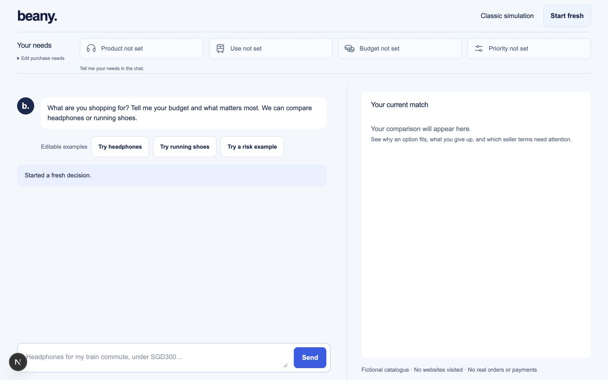
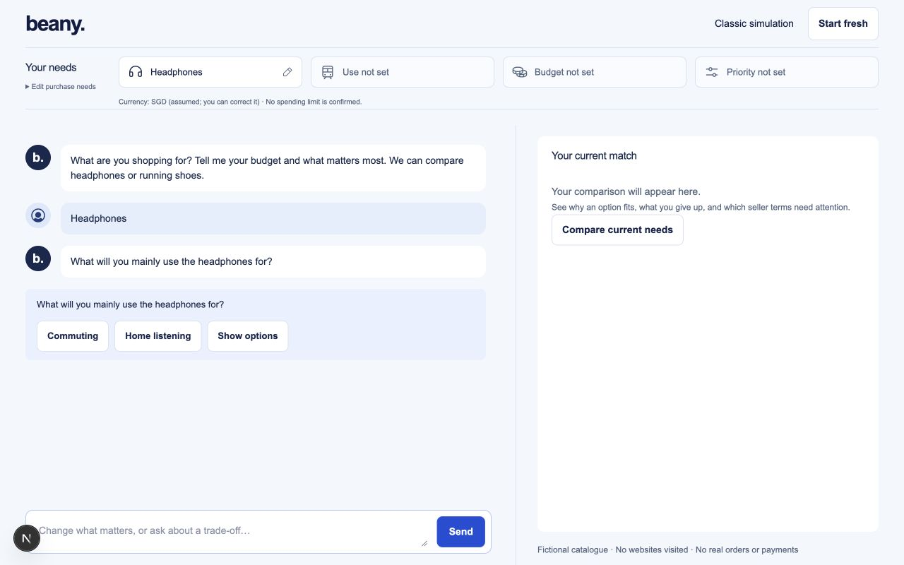
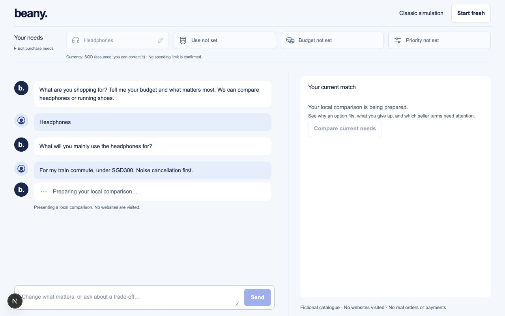
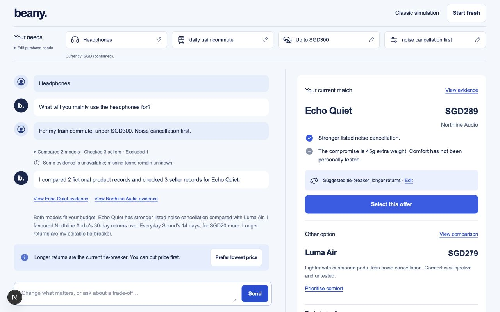
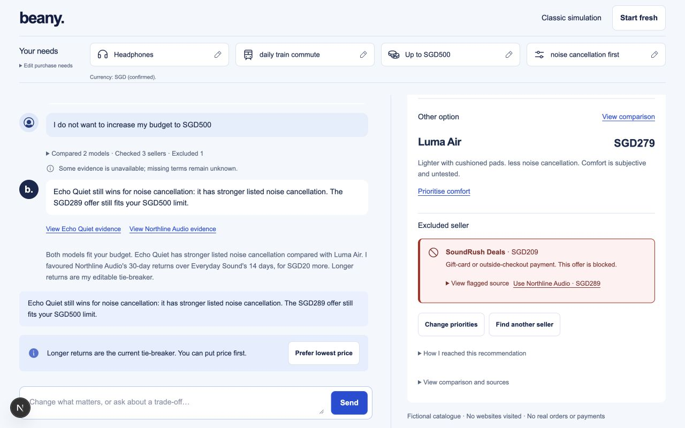
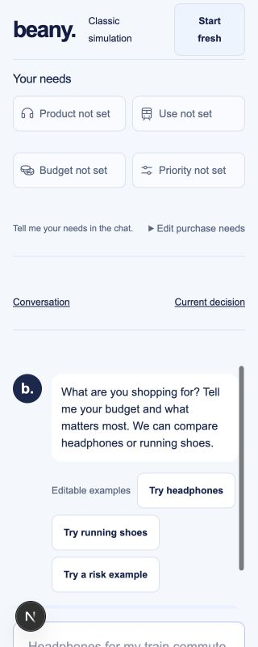
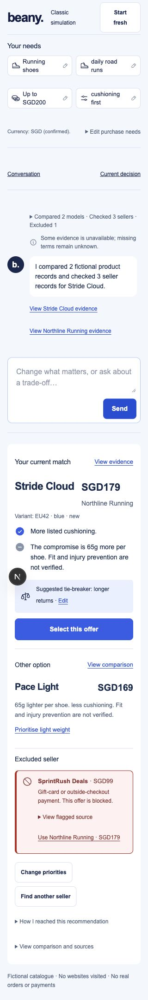
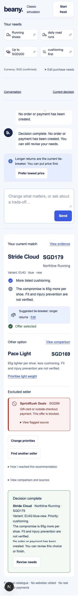
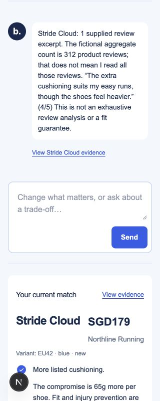
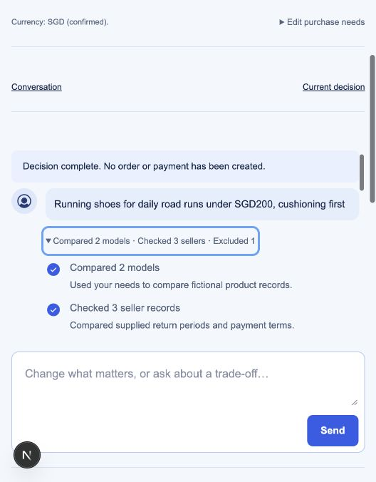

# Beany /shop: fresh UI/UX audit and release decision

29 October 2026. Implementation reviewed: local commit `4e9aef2`. No deployment, source fixes, paid APIs or real orders were performed. Independent review: [findings and exact source references](deployment-independent-review.md).

## Decision

**Good desktop interaction prototype; not ready for an unmoderated public release.** A controlled class/team demo is reasonable with a clear fictional-data introduction and supported inputs. Fix the P1 intent failures and P2 flow issues before inviting independent users to rely on it. This is a professional review judgment, not a user-study result.

The compact layout, separate current/alternative offers, expandable completed checks, explicit selection and factual evidence caveats work well. Visual polish cannot compensate for changing a hard budget against the user's instruction.

## Fresh walkthrough

All images below were captured and inspected during this audit using the in-app browser on the committed code. Desktop viewport1280×800; mobile320×800. Full-page mobile images intentionally show the long stacked layout. The ordinary console log contained no warnings/errors during the audited flows.

| Step | What was exercised | Health and evidence |
| --- | --- | --- |
| 0 | Restore the prior saved session | Compatible, but older messages have no new comparison snapshots/narrative. [00](verification/deployment-audit/00-restored-legacy.jpg) |
| 1 | Start fresh | Clear greeting, editable examples and persistent frame. [01](verification/deployment-audit/01-start.jpg) |
| 2 | Enter Headphones | A useful question is asked, but printed twice: assistant bubble and blue choice panel. [02](verification/deployment-audit/02-clarification.jpg) |
| 3 | Add commute, SGD300 and noise cancellation | Local progress is explicitly disclosed; completed summary precedes the answer; result/alternative are clear. [03](verification/deployment-audit/03-progress.jpg), [04](verification/deployment-audit/04-recommendation.jpg) |
| 4 | Select, then deny a budget increase | Incorrect: SGD300 becomes SGD500 and selection clears. The current match is also above the scrolled decision viewport. [05](verification/deployment-audit/05-negated-budget.jpg) |
| 5 | Start on mobile and compare shoes | No horizontal overflow; substantial vertical/nested scrolling. At initial load Send is y857.5–901.5, below the800px viewport. Controls are reachable through page scrolling. [06](verification/deployment-audit/06-mobile-start.jpg), [07](verification/deployment-audit/07-mobile-result.jpg) |
| 6 | Select shoes and finish | Explicit simulated completion works and says no order/payment was created. The final summary still says the user can finish, a minor copy inconsistency. [08](verification/deployment-audit/08-completion.jpg) |
| 7 | Ask about reviews | Answer correctly distinguishes one supplied excerpt from312 aggregate reviews and gives fit/evidence limitations. [09](verification/deployment-audit/09-evidence-followup.jpg) |
| 8 | Expand completed checks with Enter | Native keyboard expansion and a visible focus ring work. Other screen-reader/browser behaviours remain untested. [10](verification/deployment-audit/10-keyboard-expanded-checks.jpg) |

## Priorities before public release

1. **Intent correctness (P1):** negated budget increase/removal and negated cheapest-seller requests must preserve the stated intent or ask a question. These were independently reproduced using the source reducer; budget increase was also reproduced in the live local UI. Add adversarial assertions on the actual budget/merchant, not only reply wording.
2. **Keep the updated current match visible (P2):** after a new comparison, reset the decision pane to the new current-match heading without stealing composer focus. Do not reset users' manual reading position for evidence-only replies. The audited pane retained scrollTop382, with recommendation top≈-173px.
3. **Mobile composer access (P2):** reduce/collapse the initial needs/navigation area, reconsider the min420px conversation, and keep the input readily reachable. Test a real soft keyboard and short viewport. Page scrolling alone makes controls reachable, so this is a UX finding, not a proven WCAG violation.
4. **Conversation clarity and traceability (P2):** remove duplicated clarification/change text; keep historical evidence controls attached to the claims they support. Current links render only for the latest assistant message.
5. **Decide the deployable product boundary:** frontend-only `/shop` versus the full classic/backend application. The visible classic link/root requires a reachable configured backend; its default localhost API address is unsuitable for public visitors. If exposing paid backend chat, first add suitable access, rate and cost controls. A production-host smoke test has not been performed.

The current `/shop` still uses fictional fixtures and deterministic conversation logic. Live LLM/Browser Use integration is a separate readiness requirement; the timed progress is not evidence of a real web search.

## Evidence limits and standards

This review is grounded in current browser captures and independent code probes. Existing passing tests/builds were not treated as proof that every natural-language request or user journey works. No source changes were made to conceal findings.

No full screen-reader, real-device keyboard, Safari/Firefox, zoom, user study, penetration/load test, public-host configuration or live-provider verification was completed. A formal accessibility compliance claim would be unsupported.

The [W3C reflow guidance](https://www.w3.org/WAI/WCAG21/Understanding/reflow) informed the320px review; vertical scrolling by itself is allowed. The [Next.js production checklist](https://nextjs.org/docs/app/guides/production-checklist) reinforces that a successful build is only part of performance/security/deployment verification.

## Ordered visual evidence

